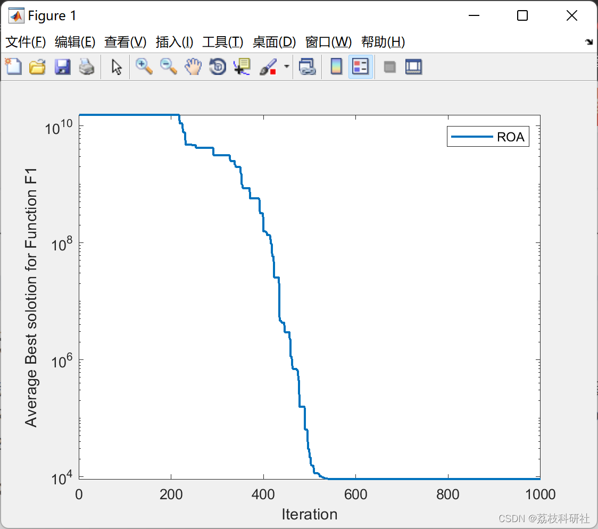
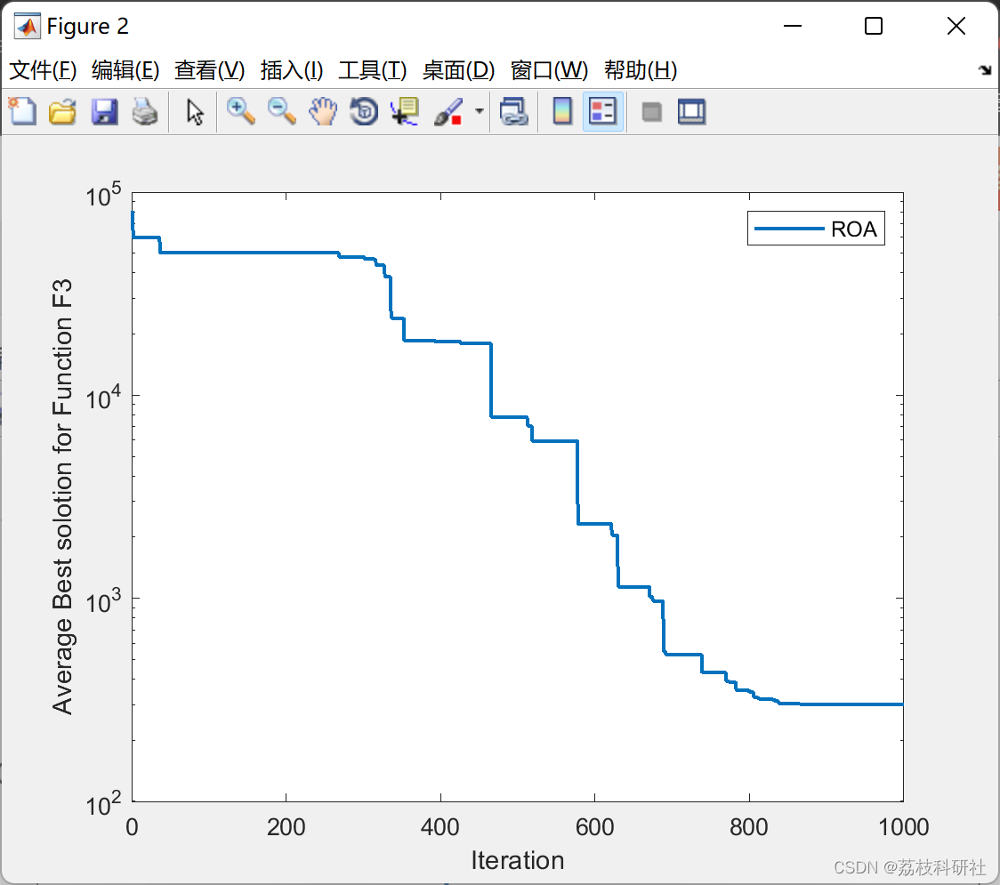
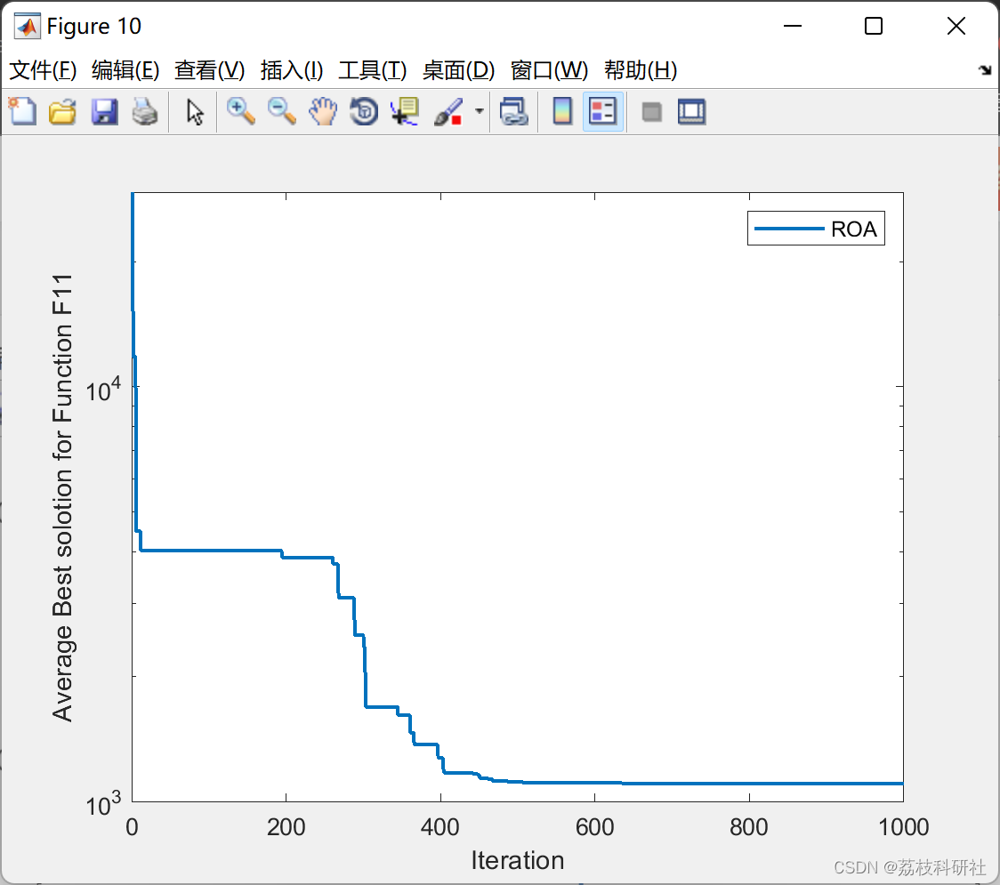
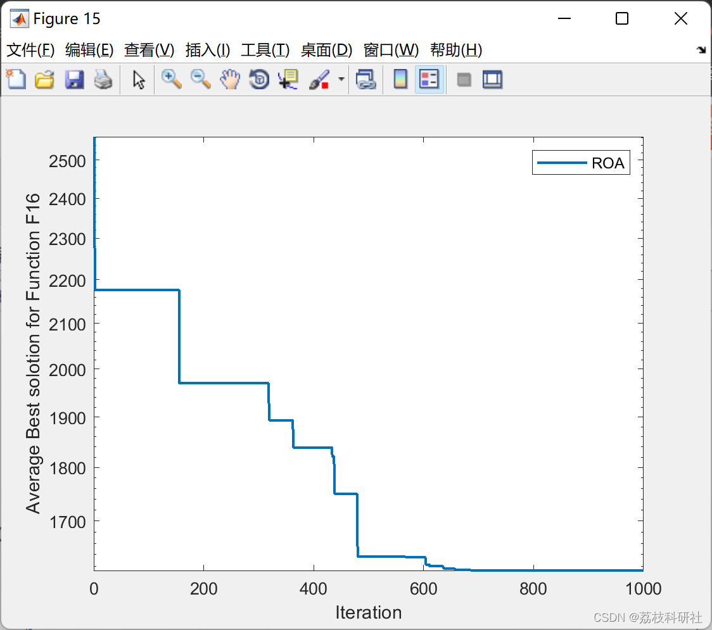
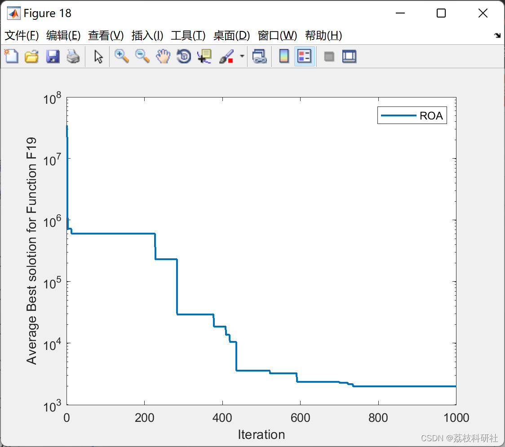
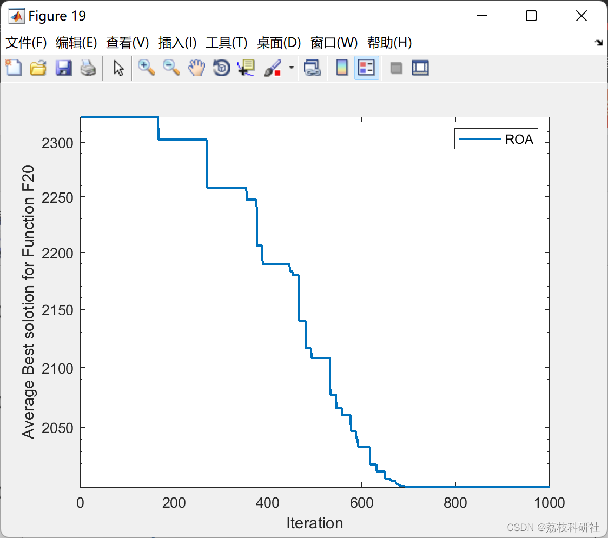

# Optimization Algorithm for Red Kite (ROA) (Matlab Code Implementation)

📚2 Run Result Edit
Edit
Edit
Edit
Edit
Edit
Edit
Part of the code:
```
function [gbest,gbestval,BestCh]= ROA(fhd,D,N,MaxIt,VRmin,VRmax,varargin)  
gbest=[];gbestval=0;BestCh=[];  
tic  
%% Problem Defination  
% fhd = fhd ;  
nPop = N ;  
nVar= D;  
VarSize = [1 nVar];  
VarMin = VRmin ;  
VarMax = VRmax ;  
%% Create All Agents  
empty_AllAgent.Position = [] ;  
empty_AllAgent.Cost = 0 ;  
empty_AllAgent.Pm = [];  
RedKites = repmat(empty_AllAgent,nPop,1);  
for k=1 : nPop  
RedKites(k).Position=unifrnd(VarMin,VarMax,VarSize);  
RedKites(k).Cost = feval(fhd, RedKites(k).Position',varargin{:});  
RedKites(k).Pm = zeros(VarSize);  
end  
costs=[RedKites.Cost];  
[~, SortOrder]=sort(costs);  
```
RedKites=RedKites(SortOrder);  
%% Algorithm Defination  
BestCostArray=zeros(MaxIt,1);  
BestCostArray(1) = RedKites(1).Cost ; % Eq. (2)  
BestAgent = RedKites(1) ;  
it = 2 ;  
for it=it : MaxIt  
%% Start Algorithm  
[ SC ,UC , D ] = ROA_PmCalculate (VarSize,MaxIt,it );               % Eq. (3) and Eq. (7)  
for i = 1 : nPop  
RedKites(i).Pm = D*RedKites(i).Pm + ...                    % Eq. (5)  
SC.*(RedKites(randi(nPop)).Position-BestAgent.Position) + ...  
UC.*(BestAgent.Position-RedKites(i).Position) ;  
RedKites(i).NewPosition = RedKites(i).Position + RedKites(i).Pm ;      % Eq. (4)  
RedKites(i).NewPosition = max(min(RedKites(i).NewPosition,VarMax),VarMin) ; % Eq. (6)  
RedKites(i).NewCost = feval(fhd, RedKites(i).NewPosition',varargin{:});    % Computing Fitness  
if RedKites(i).NewCost< RedKites(i).Cost  
RedKites(i).Position = RedKites(i).NewPosition ;             % Replacing New Red kites positions in the population  
% if they are better than previous positions  
RedKites(i).Cost = RedKites(i).NewCost ;  
end  
if RedKites(i).Cost<BestAgent.Cost                      % Eq. (2)  
BestAgent = RedKites(i) ;  
end  
end  
BestCostArray(it) = BestAgent.Cost;  
%  disp(['Iteration: ',num2str(it),' Best Cost = ',num2str(BestCostArray(it))]);  
end  
%% Send Results  
BestCh = BestCostArray';  
gbestval=BestCh(end);  
toc  
end  
🎉3 References
[2] Jalal Raeisi Gahruei, Zahra Beheshti, "Electricity Consumption Prediction using Hybrid Red kite Optimization Algorithm with Multi-Layer Perceptron Neural Network," Journal of Intelligent Procedures in Electrical Technology, (2022), Vol. 15 (60), pp. 1-22.

🌈4 Matlab Code and Detailed Article

## Images









<!-- PAYMENT_BLOCK -->

## Get this dataset

- Payment link (Stripe): [Buy now](https://buy.stripe.com/3cs8yP7sY87d0vu9AB)
- Payment QR code: 

<!-- /PAYMENT_BLOCK -->
